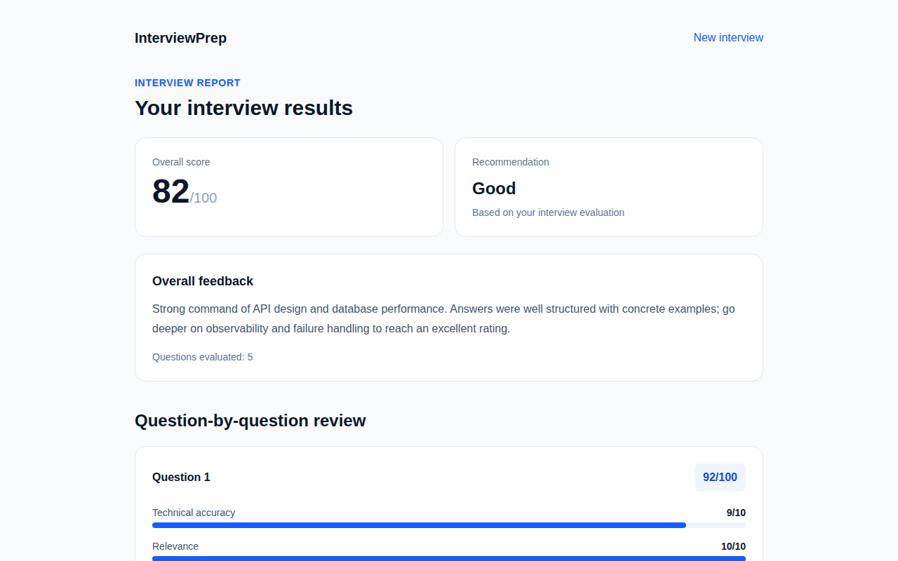
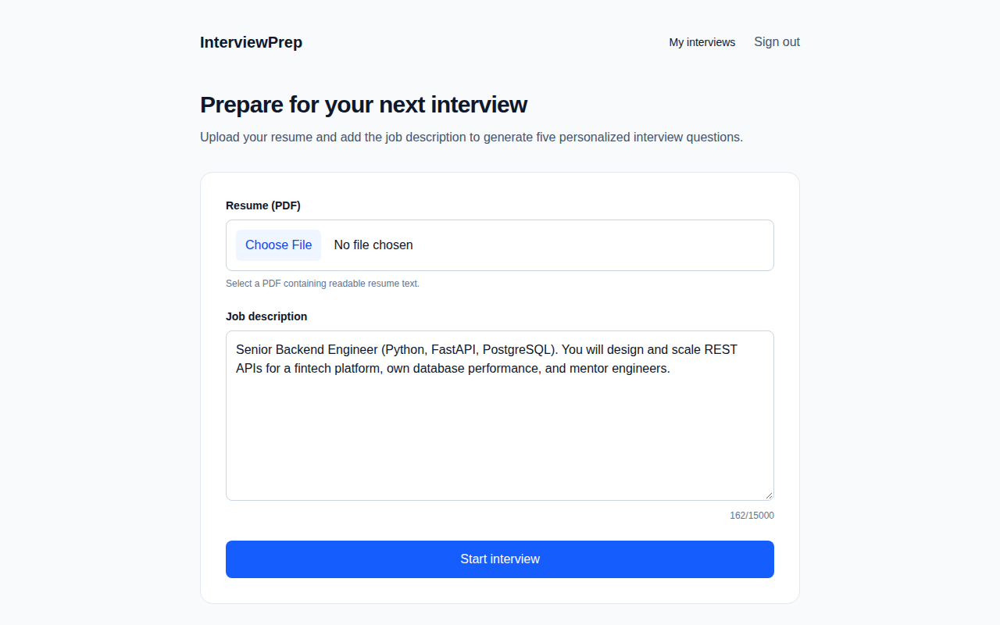
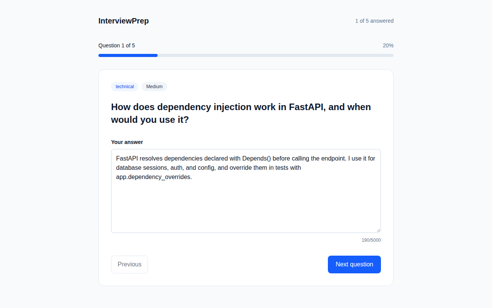
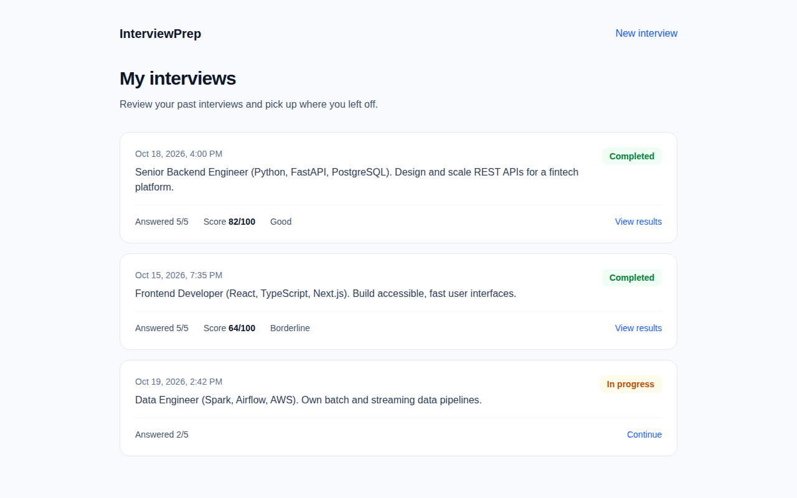

# InterviewPrep

The web front end for the [AI Interview Service](https://github.com/ai-interview-suite/api).
Users sign up, upload a resume and a job description, answer five AI-generated
interview questions, and get a scored report with per-question feedback.

Built with Next.js 16, React 19 and Tailwind CSS 4.



## Live

| | URL |
| --- | --- |
| Frontend | https://aiinterviewsuite.vercel.app |
| API | https://ai-interview-suite-api.onrender.com ([docs](https://ai-interview-suite-api.onrender.com/docs)) |

## Setup

The app needs the API running; follow the setup in the
[api README](https://github.com/ai-interview-suite/api#setup) first.

```bash
npm install
```

Create `.env.local` in this folder (next to `package.json` — Next.js does not read
env files from parent folders) and point it at the API, without a trailing slash:

```bash
NEXT_PUBLIC_API_BASE_URL=http://localhost:8000
```

If this is missing, every request fails with "Backend URL is not configured."
`NEXT_PUBLIC_*` values are read when the dev server starts, so restart it after
changing them.

## Running

```bash
npm run dev
```

Open [http://localhost:3000](http://localhost:3000). Use `localhost`, not
`127.0.0.1`: the API only accepts browser requests from the origins in its
`CORS_ORIGINS` setting, which lists `http://localhost:3000`.

## Deployment

| Part | Host |
| --- | --- |
| Frontend | [Vercel](https://vercel.com), deployed from this repo |
| API | [Render](https://render.com) web service ([api](https://github.com/ai-interview-suite/api#deployment) repo) |
| Database | [Neon](https://neon.tech) serverless PostgreSQL, AWS `ap-southeast-1` |

In the Vercel project, set `NEXT_PUBLIC_API_BASE_URL` to
`https://ai-interview-suite-api.onrender.com` for the Production environment,
then redeploy, since the value is baked in at build time. Vercel uses the
default Next.js build (`npm run build`).

If the Vercel URL changes, or you add a preview or custom domain, add it to the
api's `CORS_ORIGINS` on Render. The api is on Render's free plan, so the first
request after it has been idle can take up to a minute while it wakes up.

## Pages

| Route | Purpose |
| --- | --- |
| `/` | Landing page: log in / sign up buttons, features, how it works and app screenshots |
| `/register`, `/login` | Create an account and sign in |
| `/dashboard` | Upload a resume PDF and job description to start an interview |
| `/interviews` | List of your interviews with status, score and recommendation |
| `/interview/[interviewId]` | Answer the five questions and submit |
| `/interview/[interviewId]/results` | Overall score, recommendation and per-question feedback |

## Screenshots

The landing page shows these screenshots from `public/screenshots/`. They were
taken from the app running against a mock API with sample data, so no real
user data appears in them.

| Start an interview | Answer questions |
| --- | --- |
|  |  |
| **Review your results** | **See your history** |
|  |  |

If a page's design changes, retake its screenshot at 1280×800 so the landing
page stays accurate.

## Project layout

```
src/
  app/                 Routes (App Router), split into route groups by layout:
    (marketing)/       
    (auth)/            
    (app)/             
  components/
  lib/
public/
  screenshots/         App screenshots used on the landing page and in this README
```

## Notes and limitations

- The access token is kept in `sessionStorage`, so closing the tab signs you out.
- Interview questions are also kept in `sessionStorage` when an interview starts.
  "Continue" on an in-progress interview therefore only works in the same browser
  session; elsewhere the interview page reports that the questions are unavailable.
- If the API returns an unhandled `500`, the browser reports "Failed to fetch"
  because the error response has no CORS headers. Check the API's terminal for the
  real error — a wrong `DATABASE_URL` is the usual cause.

## Scripts

| Command | Purpose |
| --- | --- |
| `npm run dev` | Development server |
| `npm run build` | Production build |
| `npm run start` | Serve the production build |
| `npm run lint` | ESLint |
